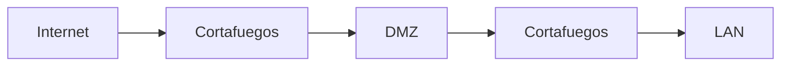

## Práctica 1 · Perímetro y zonas

### 1. Tabla de ubicación. 

| Servicio | Zona | Justificación |
|-----------|------|--------------|
Web corporativa pública | DMZ | Se comunica con internet, así que se necesita aislarla en la DMZ |
Servidor de correo | DMZ | Necesita intercambiar conexiones con internet, aislarla. |
Pasarela VPN  |  DMZ |  como es la puerta de la lan hacia internet, aislarla. |
Proxy (saliente e inverso)  | DMZ  |  Ya que actúa como un puente entre muchas redes he inspecciona el tráfico para evitar las conexiones directas de la lan a internet. |
HMI de planta y carpeta de planos |  Zona crítica |   |
Autoridad de certificación (srv-ca)  |   |   |
Servidor de copias de seguridad |    |    |
Portátiles de ingenieros y operarios  |  | |
Wi-Fi de invitados  |    |   |  
Servidor de registros y monitorización |  |  |

### 2. Tabla de flujos.

| Origen -> destino | ¿Permitido? | Ejemplo concreto |
|--------------------|-----------|---------------|
Internet → DMZ | SI  |  | 
Internet → LAN |   NO |  | 
DMZ → LAN  |  NO a menos que sea necessario  |    |  
LAN → DMZ   | si  |  |
LAN → Internet  |   |   |

### 3. Un diagrama de la red

### 4. Una pregunta de reflexión 

si cae el servidor web, ¿qué puede hacer el atacante en tu diseño y qué se lo impide?

